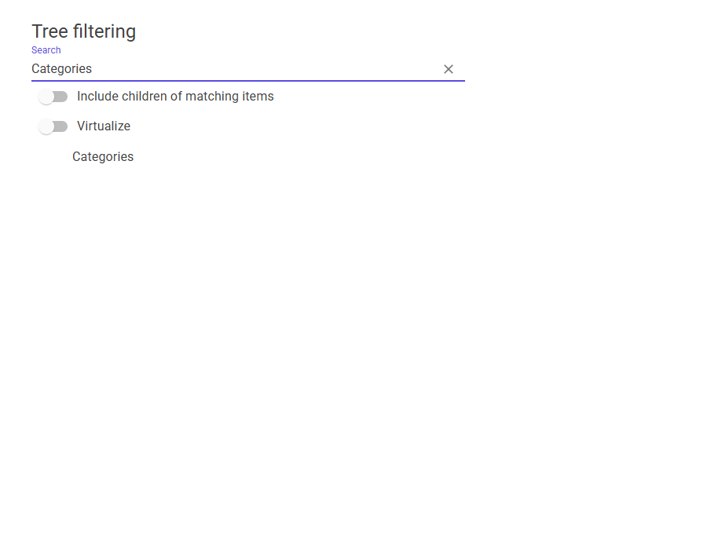
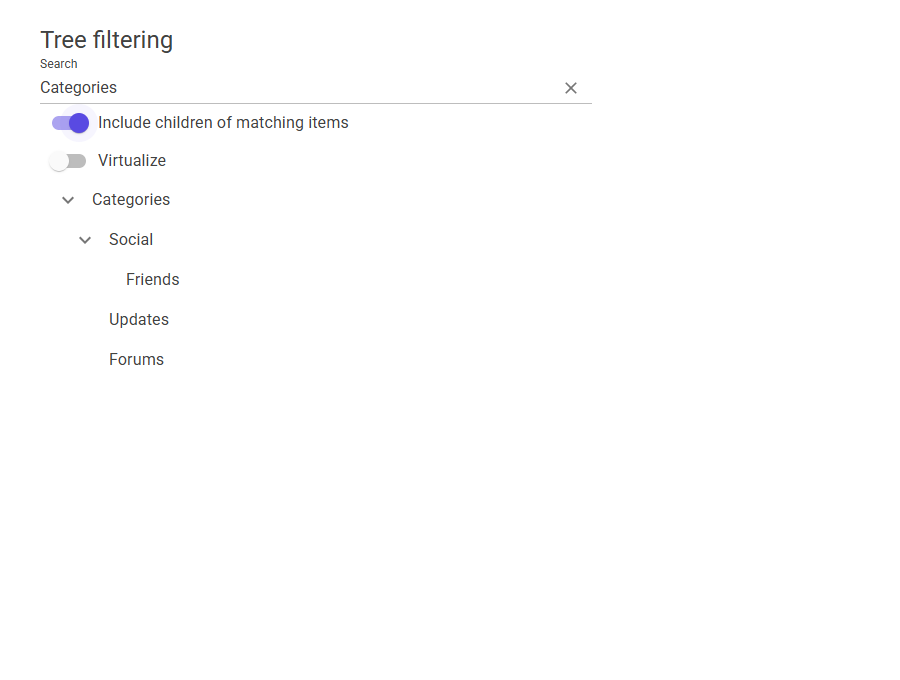

# MudTreeView filtering evidence

Recorded from a local run of the proposed change for MudBlazor/MudBlazor#10906.
The before image shows the default `FilterIncludesChildren=false` behavior; the after image shows the new option enabled, using the same search and tree.

| Default behavior | Include matching items' descendants |
| --- | --- |
|  |  |

[Short interaction video (MP4)](filter-children.mp4)

The recording covers ordinary and virtualized trees, toggling the option, matching a child, no matches, and clearing the search.
Browser: Microsoft Edge 157.0.4341.42. Viewport: 900 x 680, light, LTR.
Route: `/viewer/Scratch/TreeViewFilterChildren?theme=light&dir=ltr&chrome=none`.
The temporary Viewer component is included here for reproduction and was removed from the contribution branch after recording.
`verification.json` contains the observed DOM labels at each step. The only console error was the Viewer's missing `/favicon.ico`; no component exception occurred.

This branch stores review evidence only and is separate from the code PR.
